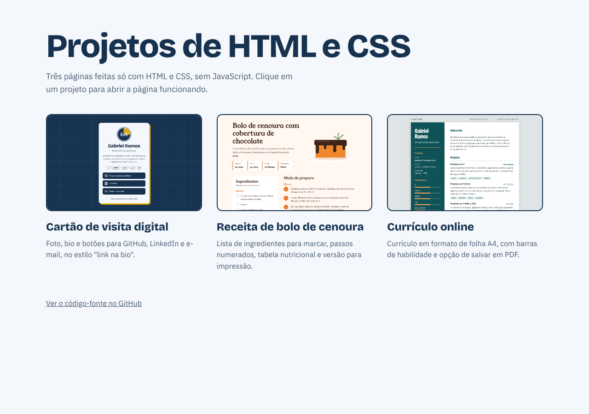

# 🎨 Projetos HTML e CSS


Coleção de páginas feitas **só com HTML e CSS**, sem JavaScript, para praticar estrutura semântica, layout, responsividade e acessibilidade.

**🌐 Veja funcionando:** [paxtel-source.github.io/Projetos-HTML-CSS](https://paxtel-source.github.io/Projetos-HTML-CSS/)



## Projetos

| Projeto | Descrição | Conceitos principais | Ver online |
|---------|-----------|----------------------|------------|
| [🪪 Cartão de Visita](cartao-de-visita/) | Página "link na bio" com foto, bio e links | Flexbox, `:hover`, `box-shadow`, SVG | [abrir](https://paxtel-source.github.io/Projetos-HTML-CSS/cartao-de-visita/) |
| [🥕 Receita](receita/) | Bolo de cenoura com ingredientes, passos e tabela nutricional | Listas, tabelas, CSS Grid, `@media print` | [abrir](https://paxtel-source.github.io/Projetos-HTML-CSS/receita/) |
| [📄 Currículo](curriculo/) | Currículo em formato A4, pronto para salvar em PDF | HTML semântico, variáveis CSS, `@page` | [abrir](https://paxtel-source.github.io/Projetos-HTML-CSS/curriculo/) |

## Organização

Cada projeto fica em sua própria pasta, sempre com a mesma estrutura:

```
projeto/
├── index.html      # A página
├── css/
│   ├── style.css   # Estilo da tela
│   └── print.css   # Estilo da impressão (quando existe)
├── img/            # Imagens usadas na página
├── docs/           # Capturas de tela para o README
└── README.md       # O que o projeto faz e como foi feito
```

Na raiz ficam a página inicial (`index.html`), que leva a todos os projetos, e o estilo dela em `assets/`.

## Boas práticas aplicadas

- **HTML semântico:** `header`, `main`, `nav`, `section`, `article`, `aside` e `footer` no lugar de `div` genéricas
- **Responsivo:** todas as páginas funcionam do celular ao computador
- **Acessível:** textos alternativos nas imagens, foco visível para quem navega pelo teclado, contraste adequado e respeito à opção de "reduzir movimento" do sistema
- **Organizado:** HTML, CSS e imagens em arquivos e pastas separados, CSS comentado e cores definidas em variáveis
- **Validado:** o HTML é verificado automaticamente pelo **GitHub Actions** a cada envio (veja `.github/workflows/validar-html.yml`)

## Como abrir no computador

Não precisa instalar nada. Baixe o repositório e dê dois cliques no `index.html`:

```bash
git clone https://github.com/Paxtel-Source/Projetos-HTML-CSS.git
```

Se preferir um servidor local (os links entre páginas funcionam melhor assim), use a extensão **Live Server** do VS Code ou rode:

```bash
python -m http.server
```

e acesse `http://localhost:8000`.

## Como publicar no GitHub Pages

1. No repositório, abra **Settings → Pages**.
2. Em **Source**, escolha **Deploy from a branch**.
3. Selecione a branch **main** e a pasta **/ (root)** e clique em **Save**.
4. Em um ou dois minutos o site estará em `https://paxtel-source.github.io/Projetos-HTML-CSS/`.
