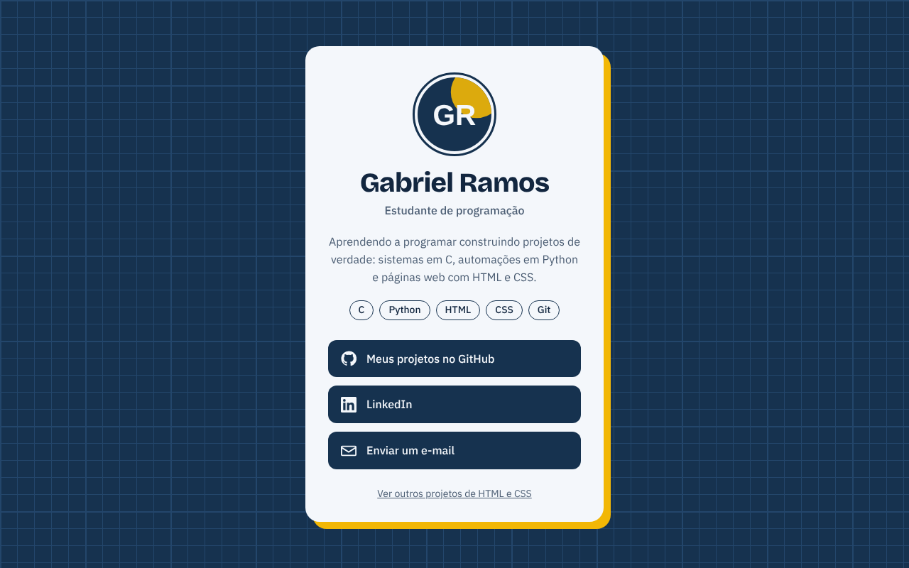

# 🪪 Cartão de Visita Digital

Página no estilo **"link na bio"**: foto, nome, uma bio curta, as tecnologias que estou estudando e botões para GitHub, LinkedIn e e-mail. Feita só com HTML e CSS.

**🌐 Ver online:** [paxtel-source.github.io/Projetos-HTML-CSS/cartao-de-visita](https://paxtel-source.github.io/Projetos-HTML-CSS/cartao-de-visita/)



## Funcionalidades

- Cartão centralizado na tela, sobre um fundo quadriculado que lembra papel de planta técnica
- Botões com ícones em SVG que mudam de cor e deslizam ao passar o mouse
- Etiquetas com as tecnologias estudadas
- Animação de entrada que é desligada para quem ativou "reduzir movimento" no sistema
- Foco visível ao navegar pela tecla <kbd>Tab</kbd>
- Responsivo: se ajusta a celulares pequenos

## Estrutura

```
cartao-de-visita/
├── index.html
├── css/
│   └── style.css
├── img/
│   └── avatar.svg     # Avatar com as iniciais (troque pela sua foto)
└── docs/
    └── preview.png
```

## Como personalizar

1. **Foto:** coloque sua foto em `img/` (por exemplo, `img/foto.jpg`) e troque o `src` da tag ``.
2. **Links:** no `index.html`, troque o endereço do LinkedIn e o `mailto:seuemail@exemplo.com` pelos seus.
3. **Cores:** mude as variáveis no começo do `css/style.css`:
   ```css
   :root {
     --azul-tinta: #16324f;  /* fundo e botões */
     --ambar: #f2b705;       /* destaque */
   }
   ```

## Como abrir

Dê dois cliques no `index.html` ou abra a pasta com a extensão **Live Server** do VS Code.

## Detalhes técnicos

- **Fundo quadriculado sem imagem:** quatro `linear-gradient` sobrepostos formam a grade fina (24px) e a grossa (120px).
- **Sombra "de papel":** `box-shadow: 10px 10px 0 var(--ambar)`, sem desfoque, dá a impressão de um cartão sobre a mesa.
- **Ícones em SVG embutido:** usam `fill: currentColor`, então mudam de cor junto com o texto do botão.
- **Centralização:** `display: grid` com `place-items: center` no `body`.

## Conceitos praticados

HTML semântico (`main`, `header`, `nav`, `footer`), Flexbox, CSS Grid, variáveis CSS, pseudo-classes (`:hover`, `:focus-visible`), `@keyframes`, `@media (prefers-reduced-motion)`, SVG.
