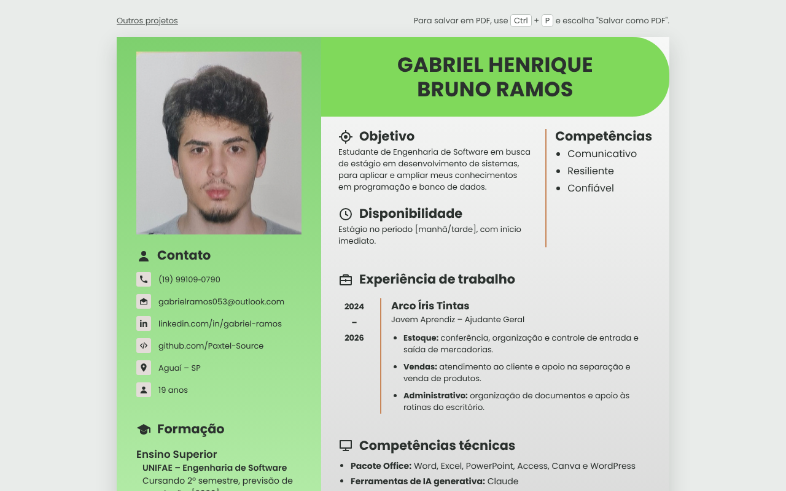

# 📄 Currículo Online

Meu currículo em formato de página web, feito só com HTML e CSS. Ele recria o visual da versão em PDF (coluna lateral verde com foto, nome em faixa verde e fundo cinza em degradê), funciona no celular e pode ser **salvo em PDF** direto do navegador, já ajustado para caber em uma folha A4.

**🌐 Ver online:** [paxtel-source.github.io/Projetos-HTML-CSS/curriculo](https://paxtel-source.github.io/Projetos-HTML-CSS/curriculo/)



## Funcionalidades

- **Coluna lateral** com foto, contato (telefone, e-mail, LinkedIn, GitHub, cidade e idade) e formação
- **Conteúdo principal** com objetivo, disponibilidade, competências, experiência, competências técnicas e projetos
- **Experiência em linha do tempo**, com o período ao lado e uma linha vertical
- **Projetos com links** para os repositórios do GitHub
- **Links clicáveis** no contato: o telefone abre a discagem no celular e o e-mail abre o aplicativo de e-mail
- **Versão para PDF:** com <kbd>Ctrl</kbd> + <kbd>P</kbd> → "Salvar como PDF", sai uma folha A4 com as cores mantidas
- **Responsivo:** no celular, o nome aparece primeiro, seguido da foto, do contato e do restante em uma coluna
- **Acessível:** ícones decorativos escondidos dos leitores de tela, rótulos ocultos ("Telefone:", "E-mail:") e foco visível

## Estrutura

```
curriculo/
├── index.html
├── css/
│   ├── style.css   # Estilo da tela
│   └── print.css   # Estilo da impressão e do PDF (A4)
├── img/
│   └── foto.jpg
└── docs/
    └── preview.png
```

## Como editar

- **Textos:** estão todos no `index.html`. Os campos entre colchetes, como `[manhã/tarde]`, ainda precisam ser preenchidos.
- **Foto:** substitua o arquivo `img/foto.jpg`, mantendo o mesmo nome.
- **Cores:** mude as variáveis no começo do `css/style.css`:
  ```css
  :root {
    --verde: #80d95b;        /* faixa do nome e detalhes */
    --verde-claro: #d6fdcd;  /* fim do degradê da lateral */
    --linha: #c8875a;        /* linhas laranja */
  }
  ```

## Como gerar o PDF

1. Abra o `index.html` no navegador.
2. Aperte <kbd>Ctrl</kbd> + <kbd>P</kbd>.
3. Em **Destino**, escolha **Salvar como PDF**.
4. Em **Mais definições**, deixe **Gráficos de plano de fundo** marcado, para manter o verde e o degradê.

## Detalhes técnicos

- **Ícones SVG reaproveitados:** todos os ícones são desenhados uma única vez em `<symbol>` e usados com `<use href="#i-email"/>`. Eles herdam a cor pelo `fill`.
- **Degradês sem imagem:** a lateral e o fundo usam `linear-gradient`, então a página continua leve.
- **Faixa do nome arredondada só à direita:** `border-radius: 0 60px 60px 0`.
- **Reorganização no celular:** `display: contents` no conteúdo principal permite usar `order` para colocar o nome acima da foto.
- **Folha A4 na impressão:** `@page { size: A4; margin: 0; }` e `print-color-adjust: exact` para imprimir as cores de fundo.

## Conceitos praticados

HTML semântico (`aside`, `article`, `section`, `time`), CSS Grid, Flexbox, variáveis CSS, `linear-gradient`, SVG com `<symbol>` e `<use>`, `display: contents`, texto oculto acessível, `@page` e `@media print`.
