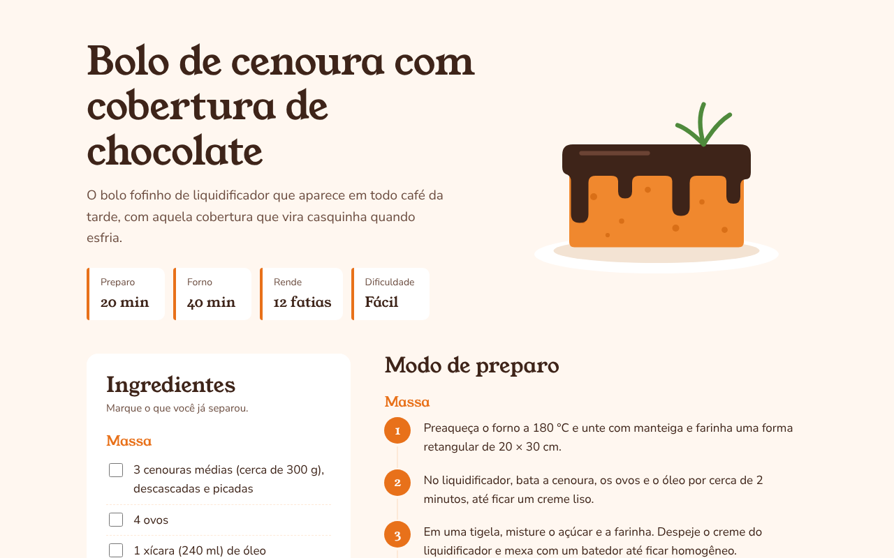

# 🥕 Página de Receita: Bolo de Cenoura

Receita de bolo de cenoura com cobertura de chocolate, feita só com HTML e CSS. Tem lista de ingredientes para ir marcando, passos numerados, tabela nutricional e uma **versão especial para impressão**.

**🌐 Ver online:** [paxtel-source.github.io/Projetos-HTML-CSS/receita](https://paxtel-source.github.io/Projetos-HTML-CSS/receita/)



## Funcionalidades

- **Resumo rápido:** tempo de preparo, tempo de forno, rendimento e dificuldade
- **Ingredientes para marcar:** ao clicar, o ingrediente fica riscado, **sem JavaScript** (usando `:has()` e `:checked`)
- **Lista de ingredientes fixa:** no computador, ela acompanha a rolagem enquanto você lê o modo de preparo (`position: sticky`)
- **Passos numerados pelo CSS**, ligados por uma linha
- **Tabela nutricional** acessível, com `caption` e cabeçalhos `th`
- **Versão para impressão:** com <kbd>Ctrl</kbd> + <kbd>P</kbd>, a página sai em preto e branco, sem a ilustração e com caixinhas ☐ para marcar à mão
- **Link "pular para os ingredientes"**, que aparece para quem navega pelo teclado
- Responsivo: no celular, tudo vira uma coluna só

## Estrutura

```
receita/
├── index.html
├── css/
│   ├── style.css    # Estilo da tela
│   └── print.css    # Estilo da impressão (media="print")
├── img/
│   └── bolo.svg     # Ilustração feita em SVG
└── docs/
    └── preview.png
```

## Como abrir

Dê dois cliques no `index.html` ou abra a pasta com a extensão **Live Server** do VS Code. Para ver a versão de impressão, aperte <kbd>Ctrl</kbd> + <kbd>P</kbd>.

## Detalhes técnicos

**Ingredientes riscados só com CSS.** Cada ingrediente é um `<label>` com um checkbox dentro. O seletor `:has()` estiliza o label quando o checkbox está marcado:

```css
.lista-checagem label:has(input:checked) {
  text-decoration: line-through;
}
```

**Números dos passos gerados pelo CSS**, com contadores:

```css
.passos { counter-reset: passo; }
.passos li { counter-increment: passo; }
.passos li::before { content: counter(passo); }
```

**CSS separado para impressão.** O `print.css` é carregado com `media="print"`, então só vale no papel:

```html
<link rel="stylesheet" href="css/print.css" media="print">
```

**Layout com `grid-template-areas`.** No computador, os ingredientes ficam à esquerda e o preparo à direita. No celular, uma única `@media` reorganiza as áreas em uma coluna.

> A tabela nutricional traz valores aproximados, calculados a partir dos ingredientes.

## Conceitos praticados

Listas (`ul`, `ol`), tabelas acessíveis, lista de definição (`dl`), formulários (`checkbox` + `label`), CSS Grid com áreas nomeadas, `position: sticky`, contadores CSS, pseudo-elementos (`::before`, `::after`), `:has()`, `@media print`, SVG.
